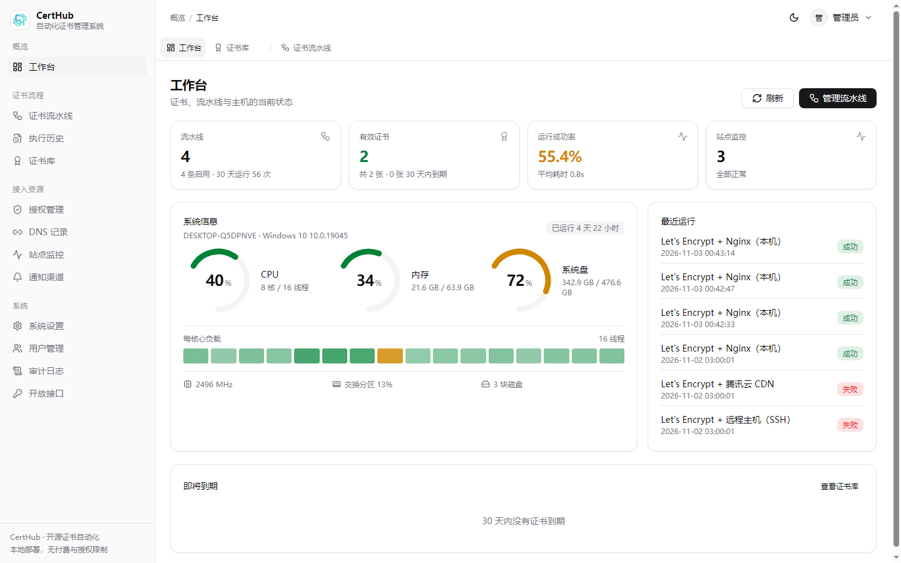
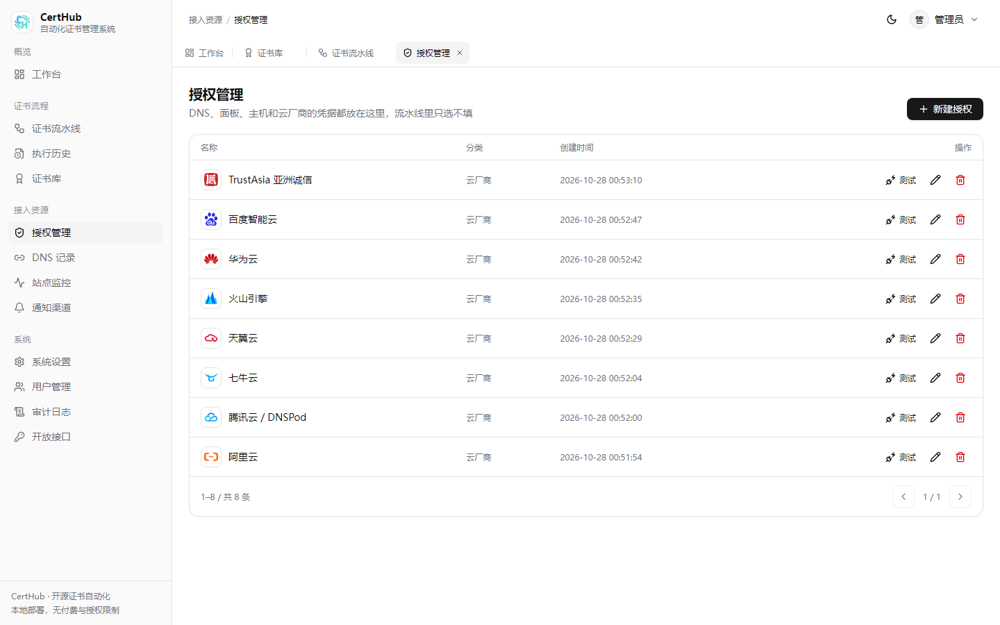
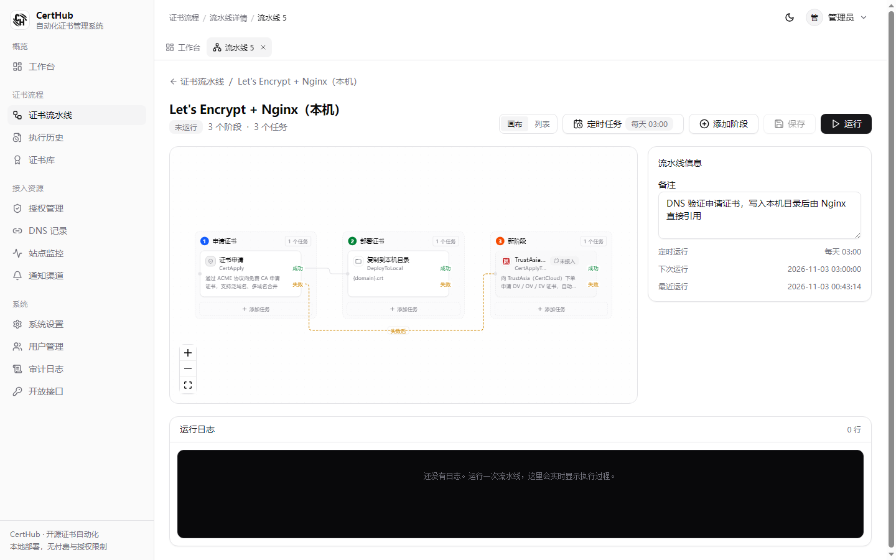
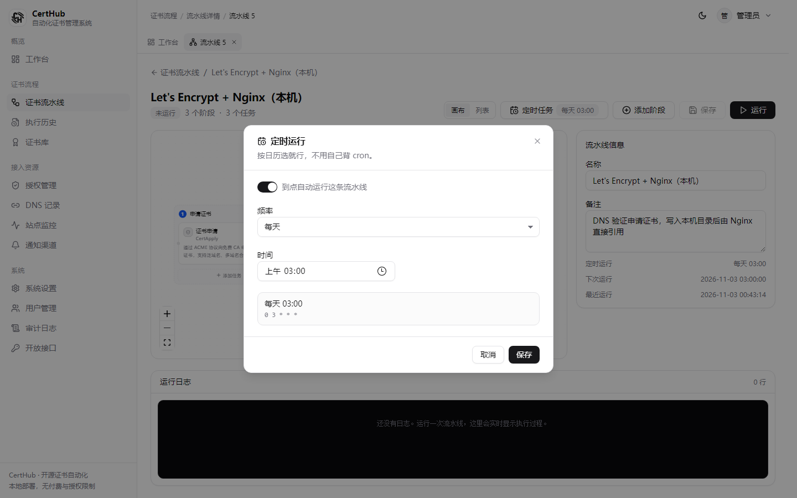
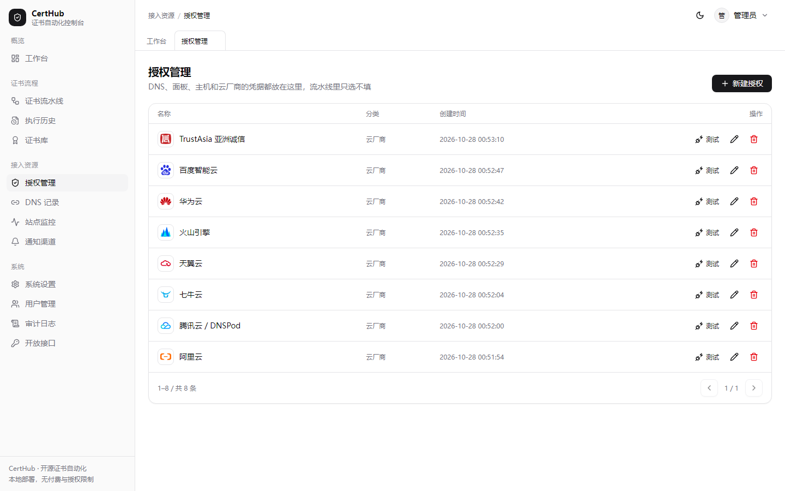
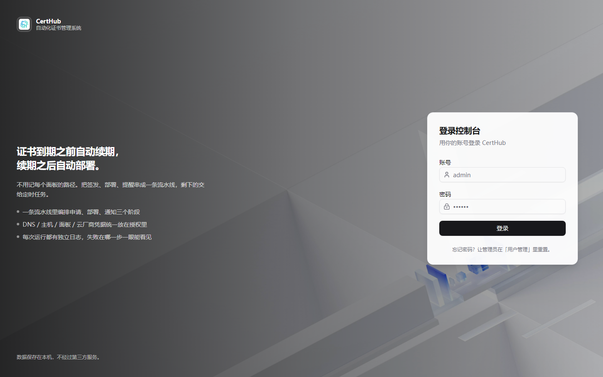
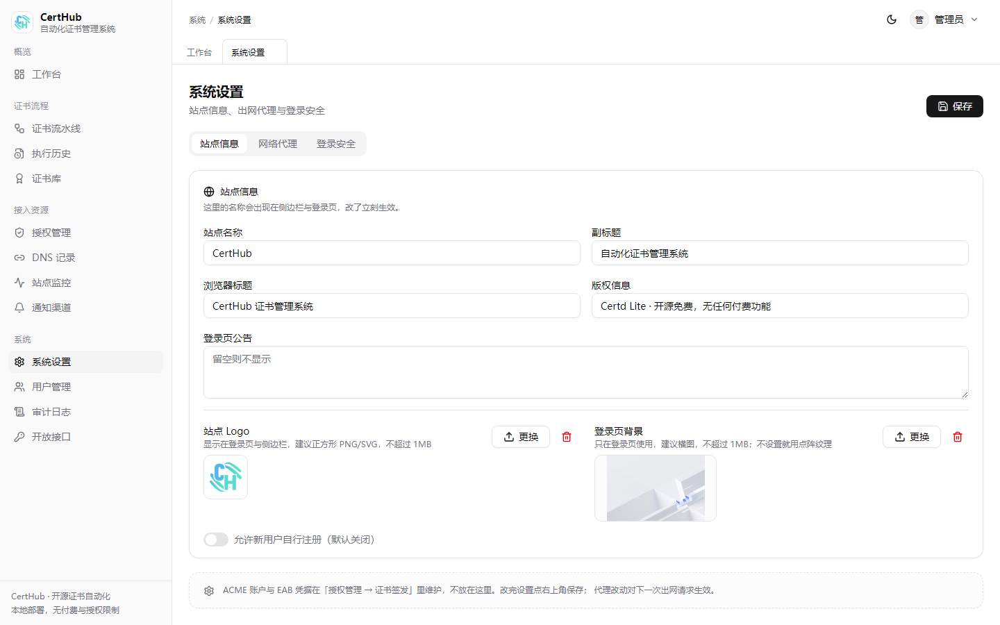
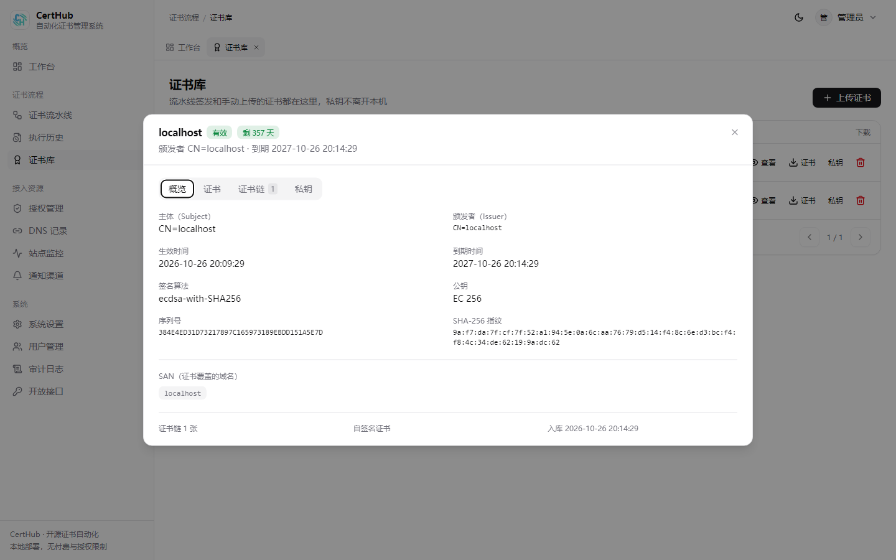

# CertHub WebUI（React + shadcn/ui）

`certd-lite` 的新前端。原前端是 Vue 3 + Element Plus 的 Art Design Pro 模板，这一份按
**shadcn/ui 默认设计语言**重写：语义色令牌、1px 描边、单一圆角源、无渐变与发光。

后端没有改动，接口、鉴权、SSE 日志全部沿用 `certd-lite/backend`。



## 技术栈

| 层 | 选择 |
| --- | --- |
| 构建 | Vite 6 + TypeScript（strict） |
| UI | React 19 + Tailwind CSS v4 + shadcn/ui 组件源码（本地实现，无 CLI 依赖） |
| 状态 | TanStack Query（服务端状态）+ 局部 state |
| 路由 | react-router-dom 7，HashRouter（与后端静态托管兼容） |
| 提示 | sonner |
| 图标 | lucide-react |
| 画布 | @xyflow/react（React Flow 12） |

只装了四个 Radix 包（`dialog` / `slot`），其余组件（Select、Switch、Tabs、Table）用原生元素
实现，样式完全走令牌，方便直接改。

## 外壳

- **面包屑**：`分组 / 页面 / 详情`，分组与页面来自同一份导航配置（`components/layout/nav.ts`）。
- **多页签**：打开过的页面留在顶栏，带图标、名称和关闭按钮，当前页签是高亮胶囊，
  非当前页签之间用 1px 分隔线；状态存 `sessionStorage`，刷新后还在，关闭当前页签会回到左边的邻居。
  **标签多了用鼠标滚轮横向滚动**（滚动条隐藏），跳转时会把当前标签自动滚进可视范围。
  **右键页签**可以「关闭左侧 / 关闭右侧 / 关闭其他 / 关闭全部」，工作台始终保留，
  没有可关的项会置灰。




- **画布 / 列表**：流水线详情页两种视图，选择记在 `localStorage`。画布按阶段横排、任务竖排，
  **每张任务卡右侧两个出口**：绿色「成功」接下一个已接入的任务，橙色「失败」按「失败后跳转」连到目标；
  点卡片打开配置，双击阶段回到列表视图。每个阶段底部有「添加任务」，**单阶段最多 5 个任务**。
- **不自动接线**：新建任务默认 `linked: false`，卡片虚线 + 「未接入」徽标，不参与执行链、画布也不连线；
  要接入就打开任务配置里的「接入流程」开关（列表视图里也有一个「接入流程」按钮）。
- **可以手动拖线**：从任务卡右侧的绿色「成功」出口拖到后面的任务 = 把它接入执行链；
  从橙色「失败」出口拖到后面的任务 = 设置「失败后跳转」。
  落点吸到卡片即可，不用精确对准左侧那个小锚点（`connectionRadius` 36 + 按落点补线）。
  连到排在它前面的任务会被拒绝并提示，因为顺序只由「阶段顺序 + 阶段内顺序」决定。
- **运行结果标色**：跑挂的任务整张卡红描边 + 红底 + 「失败」徽章，所在阶段标题也标「有失败」；
  执行中描蓝、成功的描绿。列表视图同样红描边，并把失败原因用红字显示在卡片下方。
- **卡片上直接管步骤**：任务卡底部是启用/停用开关（关掉这一步，运行时整段跳过）和删除按钮
  （hover 出现，删除前确认，并顺手清掉指向它的「失败后」引用）；阶段标题右侧常驻阶段开关，
  关掉后整段不跑，阶段删除按钮同样在 hover 时出现。画布上的这些改动只改本地草稿，
  还是要按右上角「保存」才落库。
- **阶段操作全部在卡片上**：hover 阶段标题会出现「单独运行本阶段 / 查看本阶段日志 / 重命名 / 删除」；
  任务卡 hover 会出现「查看该任务日志」。日志弹窗只显示这一次执行里属于该阶段（按
  `===== 阶段：X =====` 切段）或该任务（按 `[任务名]` 前缀过滤）的行。
- **点连线可以删**：点顺序线 = 断开那个任务的接入（`linked: false`，之后不执行），
  点「失败后」线 = 清掉失败跳转；两种都先弹确认说明后果，确认后只改草稿。
- **画布把「顺序」直接画出来**：任务卡底部标「第 N 步」（只数已接入的任务），连线带箭头表示方向，
  画布上方常驻图例（实线 = 顺序执行、橙色虚线 = 失败后跳转、虚线卡片 = 未接入不执行）。
  执行顺序永远由「阶段顺序 + 阶段内顺序」决定；连线只表达「接入 / 跳转」，不是自由拓扑，
  所以把线拖到一个排在后面的任务上，等价于「把这一步接进执行链」。
- **工作区铺满视口**：侧边栏右边第一列是任务列表（通高，下面是「定时 / 下次运行 / 备注」一行
  信息条），再往右是画布；画布下方固定 240px 的运行日志坞（可折叠）。编辑页在 `app-shell` 里
  不套 1440px 的居中宽度（其它页面仍居中），画布 `fitView` 上限放到 1.8 倍，流程会放大到基本铺满。
  任务列表里的条目可以直接**拖到画布的某个阶段**上添加，也可以点一下加到第一个阶段；添加后立刻弹配置框。
- **右键菜单**：任务卡右键 = 配置 / 复制 / 日志 / 启停 / 删除；阶段右键 = 添加任务 / 单独运行 /
  本段日志 / 重命名 / 启停 / 删除；连线右键 = 断开；空白处右键 = 添加阶段。
- **阶段卡片可以拖动摆位**：拖动阶段标题条把整块挪到画布任意位置 —— 拖动过程是跟手的连续移动，
  **松手后**才吸附到 16px 网格（和背景点阵同一套）；落点如果和别的阶段重叠，会自动沿 x 推开，
  卡片之间不会叠在一起。坐标写回 `content.layout.stages`，保存后下次打开还在原位；
  没摆过的阶段仍用自动横排。阶段框、任务卡都是不透明底色，叠在画布上不再透出网格。
- **同阶段内的连线走上下**：阶段里上一步接下一步时，线从卡片**底部中心**直落下一张卡**顶部中心**，
  不再绕到右侧横穿卡片；跨阶段才走折线，卡片间距固定 20px。
- **连线自适应避让**：跨阶段的线会生成「中缝 / 顶部走廊 / 底部走廊 / 外圈」几套候选路径，
  按「穿模次数 → 路径长度」选最优，所以卡片拖到任何相对位置都不会横穿卡片；
  连线层压在不透明阶段框之上、任务卡之下，不会因为被阶段框盖住而「消失」。
- **Ctrl/Cmd + S 保存**；有未保存改动时，右上角主按钮会从「运行」变成「保存并运行」。
- **单入边**：一个任务最多只能有一条「失败后」连线指向它，被占用时下拉项直接置灰并注明占用者。
- **自动绕行布线**：连线路径在布局阶段算好 —— 成功线走两个阶段之间的中缝，失败线走所有阶段下方的
  独立通道，再折回目标左侧，卡片不会被线条穿过（路径带 8px 圆角）。
- **标题可点击修改**：点页面标题变输入框，回车/失焦保存，Esc 取消；保存直接写回后端。
- **运行日志**：固定在画布下方，**占满内容宽度**，不再挤在右侧窄栏；运行中会实时追加并显示「实时」标记。
- **定时运行**：右上角「定时任务」按日历选（每天 / 每周 / 每月 1 日 / 自定义 cron），
  按钮上直接显示人话时间，保存写回 `content.triggers`，下次运行时间由后端计算。
- **失败后跳转**：任务配置底部可以选「失败后跳转到」后面某个任务，画布上会多一条橙色虚线并标注
  「失败后」；列表卡片也会显示「失败后 → 目标」。只允许指向后面的任务（避免成环），
  删除任务时会顺手清掉指向它的悬空引用。

- **列表页支持批量**：勾选行后顶部出现「运行 / 启用 / 停用 / 定时 / 通知 / 删除」，
  走 `POST /api/pipeline/batch`，逐条返回成功与失败（失败的会带上原因）。
  列表还补了「证书（剩余天数 + 域名）」和「触发方式（触发器数量 + 下次运行）」两列。







## 目录

```
webui/
├─ src/
│  ├─ components/
│  │  ├─ ui/             design system：button / input / card / table / dialog / switch / tabs …
│  │  ├─ layout/         侧边栏 + 顶栏外壳，导航分组
│  │  ├─ schema-form.tsx 后端插件元数据驱动的表单（授权 / 任务 / 通知共用）
│  │  ├─ log-terminal.tsx 执行日志（文本分词高亮，无 v-html）
│  │  └─ ring-gauge.tsx  240° 弧线仪表
│  ├─ features/          按页面域拆分
│  ├─ lib/               http、api、auth、类型、SSE 日志 hook
│  └─ index.css          设计令牌（light / dark 两套）
└─ vite.config.ts        /api 代理到 127.0.0.1:8000
```

## 运行

```bash
cd certd-lite/webui
npm install
npm run dev        # http://localhost:5174，/api 自动代理到后端 8000
npm run build      # tsc --noEmit + vite build
npm run deploy     # 构建后复制到 frontend/dist，刷新 http://127.0.0.1:8000 即生效
```

后端按原方式启动（`cd backend && python run.py`），默认管理员 `admin / 123456`。

`npm run deploy` 会把旧的 `frontend/dist` 改名成 `dist.bak-<时间戳>` 再写入新产物，
不会删掉原文件；想回滚把备份目录改回来即可。

## 页面

| 路由 | 页面 | 说明 |
| --- | --- | --- |
| `/login` | 登录 | 图形验证码按 `needCaptcha` 自动出现；首次登录强制绑定 2FA 时切换到绑定面板 |
| `/` | 工作台 | 统计卡 + CPU/内存/系统盘仪表 + 最近运行 + 即将到期 |
| `/pipelines` | 证书流水线 | 搜索、启停、运行、复制、删除、按模板新建 |
| `/pipelines/:id` | 流水线编辑 | 画布 / 列表两种视图；阶段与任务增删改、开关、保存、运行并看实时日志 |
| `/history` | 执行历史 | 状态筛选、日志弹窗 |
| `/certs` | 证书库 | 上传、下载、删除；点「查看」在线看概览 / 证书 PEM / 证书链 / 私钥 |
| `/access` | 授权管理 | 类型选择带厂商 logo，字段动态渲染，支持连通性测试 |
| `/dns` | DNS 记录 | CNAME（同步 / 校验）与子域名托管两个页签 |
| `/monitor` | 站点监控 | 添加、巡检、到期天数 |
| `/notifications` | 通知渠道 | 元数据驱动的新建 / 编辑 / 测试 |
| `/settings` | 系统设置 | 站点信息（含 logo / 登录背景上传）、出网代理、登录安全（验证码 / 锁定策略） |
| `/account` | 账号安全 | 基本资料、修改密码、两步验证（TOTP，扫码绑定） |
| `/about` | 关于 | 版本、开发者（北慕林奈 / 墨韵先知软媒工坊）、官网与邮箱、GitHub 更新记录与检查更新 |
| `/users` | 用户管理 | 账号、角色、用户组、两步验证状态 |

## 账号安全与用户组

- **两步验证（TOTP）**：`/account` 页「开启两步验证」→ 后端生成 `otpauth://` 链接并**在服务端画二维码**
  （`qrcode` + SVG，返回 data URL），前端 `` 直接显示，不依赖任何在线二维码服务；
  用验证器 App 扫码后输入 6 位码确认，关闭时同样要验证一次动态码。
  登录时密码通过后若账号开了 2FA，会多要一个 `code`。
- **用户组**：`sys_user_group`（名称 / 备注）+ `sys_user.group_id`，只做账号归类，
  **不参与权限判断**；用户管理页可以新建 / 改名 / 删除用户组、按组筛选、在表格里直接改某个账号的组；
  删除用户组时组内账号退回「未分组」，不会删账号。
- **用户组权限**：每个组勾选可使用的功能（`app/permissions.py` 的键：
  `pipelines / history / certs / access / dns / monitor / notifications`）。
  管理员始终全权；普通用户的有效权限 = 所属组勾选的键，前端按它过滤菜单和路由，
  后端在 router 上挂 `require_perm(key)` 再校验一次（未授权返回 403）。
  跑流水线的组一般要同时勾「授权管理」，否则任务里选不了凭据。
- **登录邮件提醒**：`系统设置 → 登录安全` 的「登录邮件提醒」（默认开）。
  登录成功后给**账号自己的邮箱**发一封提醒，包含登录时间、IP、浏览器，并提示异常登录要改密码；
  用户没填邮箱、或「通知渠道」里没有任何可用的邮件渠道时自动跳过，不影响登录。
  SMTP 参数复用邮件通知渠道，收件人固定取当前账号的 email，不会发给渠道里的其他收件人。
- **闲置自动退出**：`系统设置 → 登录安全 → 多久无操作自动退出（分钟）`，默认 30，填 0 关闭。
  前端监听鼠标 / 键盘 / 触摸 / 滚动（passive），超时后清 token 并回登录页；切回标签页会重置计时。
- **安全基线**：JWT 走 `Authorization` 头（无 Cookie，天然免疫 CSRF）；SPA 静态回退只允许 `frontend/dist` 内文件；
  刷新令牌与 API Key 都会校验账号是否仍启用；响应带 `nosniff` / `SAMEORIGIN` / `same-origin` 头。

## 关于与更新检查

- `/about` 展示版本、开发者（北慕林奈 / 墨韵先知软媒工坊）、官网 `www.htmacg.com`、邮箱 `htmacg@163.com`；
- 更新记录与「检查更新」走后端 `/api/meta/updates`：优先读 GitHub Releases，没有 Release 就退回最近 commits；
  仓库默认 `HtmACG/certhub`，可在「系统设置 → 站点信息 → GitHub 仓库」改；
- 后端请求走 `services.net`，所以系统设置里的代理对它生效；GitHub 不通时页面给中文提示，不会 500。

## 站点个性化：logo 与登录背景

系统设置 → 站点信息里可以上传两张图，前端会转成 base64 `data:` URI 存进 `sys_setting.site`：

| 字段 | 用在哪 | 建议 |
| --- | --- | --- |
| `site.logo` | 登录页品牌、侧边栏品牌 | 正方形 PNG / SVG |
| `site.loginBackground` | 登录页背景（铺满整屏，左侧加渐变压暗保证文字可读） | 横图 |

- **大小限制 1MB**：`ImageUploader` 用 `file.size` 拦，超了直接提示当前大小，不会写库。
- **公开接口**：`GET /api/site/config` 额外返回 `loginBackground`（后端只改了 `routers/site.py`
  一行和 `defaults.py` 一个默认键），登录页未登录也能拿到。
- **不填也能用**：没有 logo 用内置盾牌图标，没有背景用点阵纹理；移动端隐藏左侧文案，
  但会在表单上方补一行品牌。

登录页是左右两栏：左侧背景图 + 文案（图片上压一层深色渐变保证白字可读），右侧是**纯表单**，
不再用浮在背景上的白色卡片；窄屏只保留品牌行与表单，页面始终是纯色背景。





## 厂商标识（logo）后端插件元数据里给的是**本地相对路径**（`logoFile`，例如 `/logos/access/aliyun.svg`），
本仓库的 `public/logos/` 是从旧前端 `frontend/public/logos/` 复制过来的（access 33 个、
cert 2 个、task 14 个、issuer 6 个）。

- `VendorLogo`：优先 `` 加载本地文件；失败或没有文件时退回「品牌色底 + 首字母」。
  **不直连 CDN**，内网/离线环境不会出现空白块。
- `PluginLogo`：任务插件没有 `logoFile` 时按分组退回图标（签发 = 盾牌、部署 = 分支、通知 = 铃铛）。
- 后端新增厂商、重跑 `backend/tools/fetch_access_logos.py` 之后，把 `frontend/public/logos`
  再复制一次即可，组件不用改。

## 证书在线查看



证书库每行有「查看」，打开后四个页签，数据来自 `GET /api/cert/{id}`：

| 页签 | 内容 |
| --- | --- |
| 概览 | 主体 / 颁发者 / 有效期 / 签名算法 / 公钥 / 序列号 / SHA-256 指纹 / SAN |
| 证书 | 站点证书完整 PEM，可一键复制 |
| 证书链 | 每张链证书的主体、签发者、是否 CA、有效期，PEM 折叠查看 |
| 私钥 | 带警示条，PEM 复制；提示复制后自行保管 |

## 与旧前端的差异

1. **表单全部由后端插件元数据渲染**：新增签发 / 部署 / 授权 / 通知类型时前端零改动（与原约定一致）。
2. **凭据明文回显 + 小眼睛**：密码字段默认星号，点击显示，留空表示不修改。
3. **日志用 fetch 流解析 SSE**：`EventSource` 带不了 `Authorization`，所以自己读 `ReadableStream`。
4. **删除/停用都走确认**：不可逆操作不静默执行。
5. 路由用 hash（`#/pipelines`），与后端 `index.html` 静态托管不冲突。
6. 画布用 React Flow 12，节点位置由阶段顺序算出来，**不落库**；拖动阶段不会改数据，
   避免不同流水线的画布长得不一致。

## 构建体积

`vite build` 产物约 792 KB（gzip 248 KB），其中 React Flow 占 ~65 KB gzip。
后续如果在意首屏，可以把 `/pipelines/:id` 的路由做成 `React.lazy` 单独拆包。

## 文案约定（unslop）

界面文案按 unslop 的规则写：删掉「赋能 / 一站式 / 无缝」这类填充词，标题只写它是什么，
说明只写用户需要知道的后果（例如「留空表示不修改」「删除后调用方立刻失效」），
不用感叹号，不用「让我们一起」这类语气。
